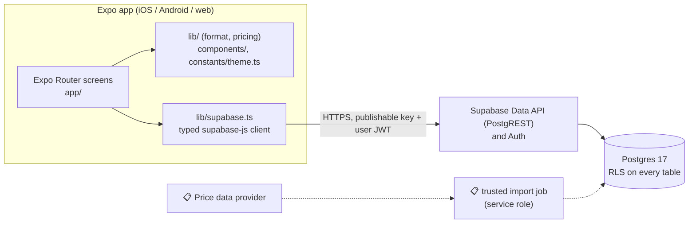
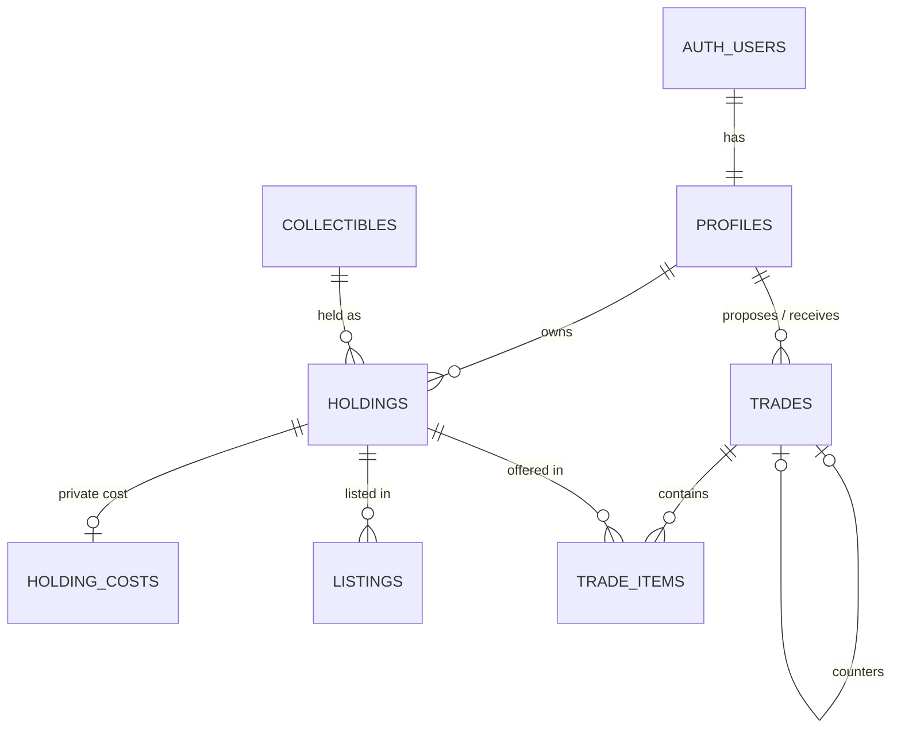
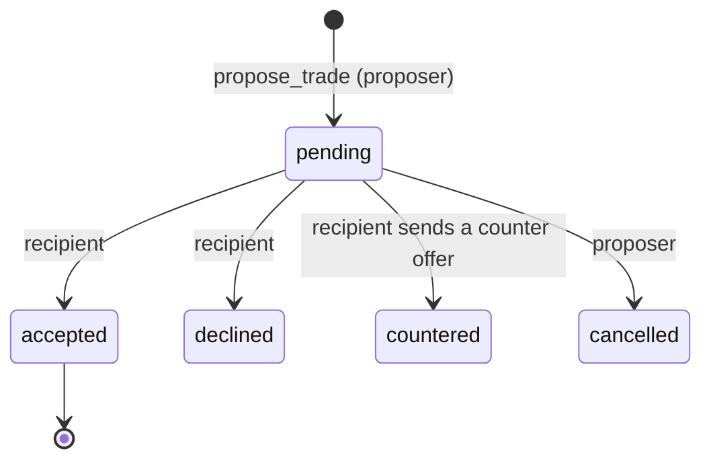

# Architecture

How BINDER is built today. Setup and commands are in [ONBOARDING.md](ONBOARDING.md). Status markers: ✅ implemented · 🚧 in progress · 📋 planned.

## Overview

- **One client, one backend.** The app talks straight to Supabase. Authorization is enforced *in the database* by Row Level Security, triggers and column grants, not in the app. There is no custom API server.
- **The client only holds the publishable key.** Anything privileged (catalog imports, executing trades) must run in trusted server code with the service role; none of it exists yet.

## Frontend ✅ (screens 📋)

| Part | Implementation |
| --- | --- |
| Framework | Expo SDK 58, React Native 0.88, React 19.3, TypeScript (strict), React Compiler enabled |
| Routing | Expo Router, file-based in root `app/` (not `src/app/`). Root `Stack` from `expo-router/stack`; tabs from `expo-router/js-tabs` (the root `Tabs` export is deprecated in SDK 58) |
| Screens | Tabs: Overview, Market, Portfolio, Trades. Stack routes: search, wishlist, `product/[id]`, `user/[handle]`, `trade/new`, `messages/*`, `(auth)/login`. All 📋 placeholders rendered by `components/Screen.tsx` |
| Design system | Dark tokens in `constants/theme.ts`, taken from `wireframe/WF_reference.html` (the clickable prototype and design reference) |
| Data access | `getSupabase()` in `lib/supabase.ts` creates the client on first use and stores the session in `expo-sqlite` localStorage. It is typed with the generated `types/database.ts`; app aliases live in `types/index.ts` |
| Logic | `lib/pricing.ts` computes portfolio value, cost basis and profit/loss in integer cents; `lib/format.ts` formats money and percentages |

## Database

Schema: `supabase/migrations/20261022020652_mvp_schema.sql` (✅ merged and tested; 🚧 not yet applied to the shared dev project).

| Table | Purpose |
| --- | --- |
| `profiles` | Public identity (username, display name, avatar), 1:1 with `auth.users`. No email |
| `collectibles` | Shared catalog: a card printing or a sealed product. Read-only for clients |
| `holdings` | A physical item someone owns. `item_type` raw / graded / sealed decides which of `condition`, `grading_company`, `grade` apply. One row per raw/sealed variant; one row per graded slab |
| `holding_costs` | Purchase cost and date; **visible only to the owner** |
| `listings` | A holding for sale: price, quantity, status `active` / `sold` / `cancelled` |
| `trades`, `trade_items` | Offers between two users, with optional cash and the side each item comes from |

**Key rules**
- **Money is `numeric(12,2)`**, never floating point.
- **Ownership is guaranteed by foreign keys.** Listings, trade items and costs reference `holdings (id, owner_id)` together, so no one can list or trade an item they don't own.
- **RLS on every table:**
  - Anonymous visitors read profiles, the catalog, active listings and open-to-trade holdings.
  - Signed-in users manage their own rows.
  - Trades are visible only to the two participants.
- **Column-level grants** keep ids, timestamps and server-managed fields out of clients' hands.

**Trades** are created atomically with the `propose_trade(...)` RPC (`SECURITY INVOKER`, so every RLS rule still applies). Status changes are enforced by a trigger:

- Terms can't be edited after sending.
- Accepting requires every item to still be owned in the offered quantity.
- Each trade can be countered once.
- At most 5 pending offers from one user to the same recipient.
- 📋 Moving ownership after acceptance is not built. It needs trusted server code (it must also delete the seller's cost row).

**Tests:** 129 pgTAP tests in `supabase/tests/database/`. They run locally in PGlite (`npm run test:db`) and in CI on Supabase's Postgres 17 image.

## Authentication 📋

Not implemented. Planned: Supabase Auth, where the app signs in and supabase-js sends the user's JWT with every request. The database is already prepared:
- Every policy uses `auth.uid()`.
- `profiles.id` references `auth.users`.
- Deleting an account cascades to that user's data.

Profiles will be created by the app after sign-up; whether to switch to a trigger is still open.

## External integrations 📋

None configured. Market prices will come from a third-party provider (research in the Obsidian vault, `docs/MCE/`), imported on a schedule by trusted code into the catalog. The app will never call the provider directly.

## Infrastructure, CI and deployment

| | Status |
| --- | --- |
| Hosting / deployment | 📋 None. No EAS project and no web hosting |
| Supabase | Hosted shared **dev** project (⚙️ link per [ONBOARDING.md](ONBOARDING.md#6-database-supabase)); no production project yet |
| CI: `.github/workflows/claude-checks.yml` | Every PR and push to `main`: `ship.mjs check --e2e`, which runs lint, types, Jest, web export, dependency audit, database tests, wireframe smoke test, docs check and secret scan |
| CI: `.github/workflows/database.yml` | When database files change: migrations and pgTAP tests on Supabase's image, security/performance advisors, check that `types/database.ts` is current |
| CI: `.github/workflows/documentation-check.yml` | Every PR: docs accuracy, and that setup-sensitive changes come with docs updates or an explicit "no docs needed" |
| Local guards | `.githooks/` (secret scan on commit; push guard for Claude Code) and `.claude/hooks/git-guard.mjs` |
| Claude Code ↔ Supabase | `.mcp.json`: Supabase's hosted MCP server, limited by `SUPABASE_PROJECT_REF` to the shared dev project, with read-write access. Each developer signs in with their own Supabase account (⚙️ setup per [ONBOARDING.md](ONBOARDING.md#claude-code-optional-shared-through-the-repo)) |

## Important decisions

Full history with alternatives is in the Obsidian vault (`docs/MCE/Decisions.md`).

- **Expo + Supabase, no custom backend.** Security lives in Postgres (RLS, triggers, grants), and is tested with pgTAP.
- **Condition and grade belong to the physical copy** (`holdings`), not the catalog. Purchase cost is in a separate owner-only table, because RLS hides rows, not columns.
- **Root `app/` layout kept** from the original scaffold; SDK 58 APIs chosen from the versioned docs.
- **Dependency audit with reviewed, expiring exceptions** (`.claude/audit-allowlist.json`) instead of disabling it.
- **`main` changes only through PRs with green CI.** Schema changes are applied to the shared project by one person after merge.
