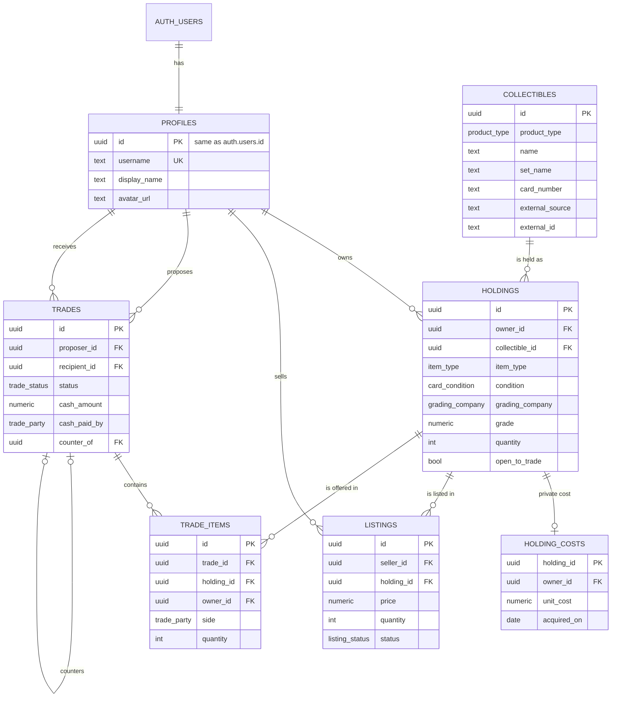

# Database

> [!important] Source of truth
> Setup and the actual implementation are documented in the repo: `ONBOARDING.md` and `ARCHITECTURE.md` at the repository root. This note keeps the full design rationale; `ARCHITECTURE.md` has the current summary and wins on any conflict.

Supabase Postgres (17 on hosted projects). The schema lives in version-controlled migrations under `supabase/migrations/`; this note explains it. Back to [[Home]]. Related: [[Architecture]], [[Decisions]].

> [!info] Status
> ✅ Migration `20261022020652_mvp_schema.sql` is written, independently reviewed (security audit plus code review, all findings fixed), and covered by 129 pgTAP tests. Every test also fails when its rule is deliberately broken. Applied to the shared dev project on 2026-10-23.

## Tables

| Table | Holds | Who can read | Who can write |
| --- | --- | --- | --- |
| `profiles` | Public identity: `username`, `display_name`, `avatar_url` (1:1 with `auth.users`) | Everyone | The user, for their own row |
| `collectibles` | Shared catalog: one row per card printing or sealed product (`product_type` card/sealed, name, game, set, card number, image, external catalog id) | Everyone | Trusted server only (service role), e.g. a price-feed import |
| `holdings` | A physical item someone owns: collectible, `item_type`, condition or grading, quantity, `open_to_trade` | Owner; everyone for open-to-trade or actively listed items; trade participants for items in their trade | Owner |
| `holding_costs` | Private purchase data per holding: `unit_cost`, `acquired_on` | Owner only | Owner |
| `listings` | A holding offered for sale: price, quantity, status (active/sold/cancelled) | Everyone for active listings; seller for all their own | Seller |
| `trades` | A trade proposal: proposer, recipient, status, optional cash and who pays it, message, counter-offer link | The two participants | Proposer creates; status changes only (see below) |
| `trade_items` | Items in a trade: holding, owner, `side` (which party gives it), quantity | The two participants | Proposer, while the trade is pending |

All money is `numeric(12,2)` in USD. There are no float columns (a test checks this).

## How variants work

A catalog row is the *product*; condition and grade belong to the *physical copy*, so they live on `holdings`:

| `item_type` | Required | Not allowed |
| --- | --- | --- |
| `raw_card` | `condition` (near_mint … damaged) | grading fields |
| `graded_card` | `grading_company` (PSA, BGS, CGC, SGC, TAG) and `grade` (1–10 in half steps); optional `cert_number`; quantity is always 1 | `condition` |
| `sealed_product` | (nothing extra) | condition and grading fields |

A raw near-mint copy and a PSA 10 of the same card are therefore separate holdings with different values, and a sealed product can't be stored as a card (a trigger checks `item_type` against the collectible's `product_type`).

**One row per variant.** For raw cards and sealed products, each owner has at most one row per collectible, type and condition; more copies means a higher `quantity`. Each graded slab is its own row, even when two have the same grade.

## Relationships

**Ownership is enforced by foreign keys.** `listings (holding_id, seller_id)`, `trade_items (holding_id, owner_id)` and `holding_costs (holding_id, owner_id)` all reference `holdings (id, owner_id)` together, so a row can only point at a holding owned by the person it names, regardless of who writes it.

**Delete behaviour:**
- Deleting an auth user removes their profile, holdings, costs, listings and trades, even if they have pending trades.
- Deleting a holding removes its cost and listings. It's **blocked while the holding is in a pending or accepted trade**; after a trade is declined, cancelled or countered, the owner can delete it.
- Catalog items that someone holds cannot be deleted.
- A holding's owner can't change while it has a cost row, a listing or trade items. The future trade-execution code must delete the seller's cost row, never pass it to the buyer.

## Row Level Security

Every table has RLS enabled, and access is granted explicitly. Supabase no longer exposes new tables to the Data API automatically; that is enforced on all projects from 2026-10-30.

- **Anonymous visitors** can read profiles, the catalog, active listings, and holdings that are open to trade or listed. Nothing else, and no writes.
- **Signed-in users** additionally see and manage their own holdings, costs and listings, and see trades they take part in.
- **Purchase cost is never visible to anyone but the owner.** It's in its own table because RLS works per row, not per column.
- **Impersonation is blocked.** Every insert and update checks the row's owner against `auth.uid()`, and the update rules stop a user moving a row to someone else.
- **Trade rules,** enforced by a trigger and by update rights limited to the `status` column:
  - Only the recipient can accept, decline or counter; only the proposer can cancel.
  - Only `pending` trades change; nothing moves back to `pending`.
  - The terms (parties, cash, message) can't be edited.
  - Accepting requires at least one item, with every item still owned in the offered quantity.
  - Items can only be added by the proposer, **in the same transaction that creates the trade**, so the recipient always sees the complete terms. A requested item must be open to trade, and each item must come from the party on its side.
  - At most 5 pending offers from one user to the same recipient.
- **Proposing a trade:** call the `propose_trade(p_recipient, p_items, p_cash_amount, p_cash_paid_by, p_message, p_counter_of)` RPC. It creates the trade and its items in one transaction and runs as the caller (`SECURITY INVOKER`), so all the rules above apply. `p_items` is `[{"holding_id": "...", "side": "proposer" | "recipient", "quantity": 1}]`. Signed-in users only.
- **A counter offer** is a new trade with `counter_of` pointing at the original and the parties swapped. Creating it marks the original `countered`. Each trade can be countered once; the original is locked while this is checked.
- **Visibility after a trade ends:** participants see each other's traded holdings only while the trade is pending or accepted.
- **Server-managed fields:** clients may only write the columns they own. They can't set timestamps, `responded_at`, a new trade's `status`, or a new listing's `status`; ownership changes are blocked too. Clients may supply their own UUIDs for new rows.
- **Holding quantity** can't drop below what an active listing is selling.
- **Helper functions** live in a `private` schema that the API doesn't expose. They run as the caller (`SECURITY INVOKER`), so they never bypass RLS.

### Needs trusted server-side logic (not built yet)

- **Executing an accepted trade** (moving holdings between users, settling cash) must happen atomically in trusted code: a server function or an RPC in a non-exposed schema with explicit `auth.uid()` checks. Clients can't move holdings between users today.
- **Marking a listing sold to a buyer**, once purchases exist.
- **Catalog imports** from the price data source, which use the service role (see [[Projects/Collectibles Trading Platform/10 - Price Data Source|Price Data Source]]).

## Working with migrations (both developers)

One-time setup:
1. `npm install` installs the pinned Supabase CLI (2.121.0) and the test tools.
2. Copy `.env.example` to `.env` and fill it from the shared dev project. Never commit `.env`.
3. `npx supabase login` with a **scoped** personal access token, then `npx supabase link --project-ref <ref>`.

Changing the schema:
1. `npx supabase migration new <name>` creates a timestamped file. Never edit a migration that has already been applied anywhere; add a new one.
2. Write SQL in that file, and add or adjust tests in `supabase/tests/database/`.
3. `npm run test:db` runs every migration and test in PGlite, with no Docker needed.
4. With Docker: `npx supabase start`, then `npx supabase test db` and `npm run db:types`.
5. Commit on a feature branch and open a PR. The **Database** CI workflow runs the tests on Supabase's Postgres image, runs the advisors, and checks `types/database.ts`.
6. After review and merge, **one person** applies it to the shared dev project with `npx supabase db push` (preview first with `--dry-run`). Never change the schema in the dashboard.

## Environment variables

| Variable | Where | Notes |
| --- | --- | --- |
| `EXPO_PUBLIC_SUPABASE_URL` | App | Project URL; public |
| `EXPO_PUBLIC_SUPABASE_PUBLISHABLE_KEY` | App | Publishable key; safe in the client because RLS guards the data |
| `SUPABASE_ACCESS_TOKEN` | Developer machine / CI | Scoped personal access token for the CLI |
| `SUPABASE_PROJECT_REF` | Developer machine | Shared dev project ref |
| `SUPABASE_DB_PASSWORD` | Developer machine | Needed by `supabase db push` |

The secret (service role) key never goes in the app, the repo, or these notes.

## Known limitations

- **Local tests run on Postgres 18** (PGlite), while hosted Supabase runs 17. CI repeats the tests on Supabase's own image to cover the difference.
- **Trade acceptance only records agreement.** Ownership doesn't move yet (see above).
- **There's no buyer "interest" table yet,** though the marketplace MVP needs one.
- **The offer limit is basic anti-spam** (5 pending per recipient). There's no rate limiting, blocking or reporting yet.
- **Trade item quantities are checked when the offer is created and again on acceptance,** not continuously. An offer can become unacceptable if the owner sells copies in between.
- **Each collectible has one external catalog id.** Supporting several price providers needs a mapping table.
- **Profiles are created by the client after sign-up.** There's no trigger on `auth.users` yet.
- **USD only.**

## Planned schema changes

- 📋 `listing_interests` (buyer expresses interest in a listing), with the seller and that buyer allowed to see each row.
- 📋 A trusted function to execute accepted trades, plus a `completed` status.
- 📋 User blocking and reporting, and real rate limiting for trade offers.
- 📋 Price history table fed by the price data source, and portfolio value snapshots.
- 📋 Optional profile auto-creation trigger once the sign-up flow is designed.
