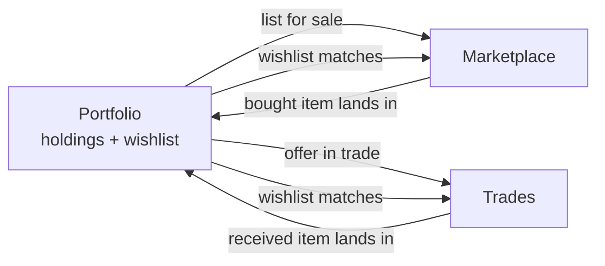

# Solution

Back to [[Index]]. Problems addressed: [[01 - Problem]].

## The three pillars

### 1. Portfolio
- Add items by search (later, by scanning a photo or a grading certification number).
- Each holding records variant (raw condition, graded + grader + grade, or sealed), quantity, cost basis and date acquired.
- Dashboard: total value, change over time, biggest movers, unrealized gain and loss.
- Wishlist: cards you're looking for, with target prices.

### 2. Marketplace
- List a holding for sale straight from the portfolio, with a suggested price from market data.
- Search and filter listings; the "under market price" feed from the wireframe.
- Checkout through a payments provider; ship with tracking; buyer protection rules.

### 3. Peer-to-peer trades
- Propose a trade by picking items from your portfolio and theirs; add cash to either side.
- Counter-offer until both accept, then both ship.
- Every trade shows the market value of each side so the gap is visible.
- Later: verification through a hub or a partner (see [[05 - MVP Roadmap]] Phase 4).

## How they work together

The portfolio is the hub. Anything bought or received in a trade updates holdings and cost basis automatically. The wishlist and holdings power matching: "these 3 collectors have a card you want and want a card you have."

## Key user journeys

1. **First visit:** sign up, add 10 cards by search, see total value. Value delivered without any other users.
2. **Sell a card:** open a holding, tap Sell, accept the suggested price, list it. After it sells, the holding closes and the gain is recorded.
3. **Make a trade:** see a wishlist match, open the other collector's binder, propose 2 cards + $15 for 1 card, counter, accept, both ship, both mark received, and both portfolios update.
4. **Check performance:** open the Portfolio tab and see value over 30 days, biggest movers and realized vs unrealized gains.

## Differentiation opportunities

| Opportunity | Why it could matter | Confidence |
| --- | --- | --- |
| Trades drawn from tracked collections | Collectr tracks but doesn't trade; Veriswap trades but isn't a full portfolio tracker | ⚠️ Medium: Collectr or Veriswap could add the missing piece |
| Cost basis carried through trades | Few tools handle cost basis on non-cash trades | ⚠️ Need to confirm what competitors do |
| Sealed product trading | Veriswap excludes sealed Pokémon product (✅ per its help center) | ⚠️ Low: it may be excluded because resealing fraud is hard to verify |
| Reputation that follows the user | Replaces Discord "vouch" channels | ⚠️ Only valuable once there is trading volume |
