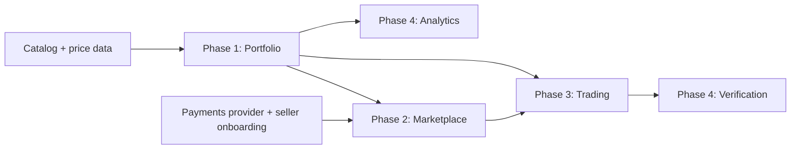

# MVP Roadmap

Back to [[Index]]. Codebase roadmap: [[Roadmap]].

> [!tip] Principle
> Ship the part that is useful to **one** user first. The marketplace and trading only work once enough people are using the app, so the tracker has to bring those people in.

## Phase 1: Portfolio tracker 📋

**Goal:** a collector can add their Pokémon collection and see what it's worth.

- Sign up and log in.
- Pokémon catalog search (cards and sealed products).
- Add holdings: raw (condition), graded (grader + grade), sealed; quantity, cost basis, date acquired.
- Portfolio dashboard: total value, change over time, biggest movers.
- Wishlist.
- Public profile ("binder") that others can view.

**Done when:** 50+ testers keep using it weekly. ⚠️ This target is a placeholder; set it after interviews.

## Phase 2: Marketplace 📋

**Goal:** a holding can be listed and sold.

- List from the portfolio with a suggested price.
- Search, filters, product pages, "under market price" feed.
- Checkout through a payments provider; seller payouts.
- Shipping with tracking; order statuses; disputes.
- Seller ratings.

## Phase 3: Peer-to-peer trading 📋

**Goal:** two collectors can agree and complete a trade.

- Trade builder: items from both binders plus optional cash.
- Counter-offers; messages tied to each trade.
- Both sides ship and confirm receipt; cash part collected through the payments provider.
- Wishlist-based trade matching.
- Reputation from completed trades.

## Phase 4: Advanced analytics and verification 📋

- Premium analytics: longer history, price alerts, export, realized gain/loss reports.
- Verification: partner with a grader or authenticator, or run a hub (❓ decide after Phase 3 data).
- Scan to add (photo recognition, certification number lookup).

## Dependencies

- **Price data** blocks everything. Phase 1 can't ship without it.
- **Payments provider** (with seller identity checks) blocks Phase 2 and the cash part of Phase 3.
- **Shipping and dispute handling** from Phase 2 are reused in Phase 3.

## Priorities

1. **Must:** catalog, holdings, valuation, wishlist, public binder.
2. **Should:** marketplace listing and checkout.
3. **Could:** trading, scanning, premium analytics.
4. **Later:** own verification hub, categories beyond Pokémon.

## Risks to the roadmap

| Risk | Effect | Response |
| --- | --- | --- |
| Can't get price data on reasonable terms | Phase 1 blocked | Choose a provider before writing app code |
| Tracker isn't better than Collectr | Few users, so Phases 2–3 have no one to sell to | Find a clear advantage in interviews (e.g. cost basis, trade history) |
| Marketplace has too few listings | Buyers leave | Recruit sellers before launch; see [[06 - Go To Market]] |
| Fraud in early trades | Damages trust early | Start with trading limits, reputation rules and value caps |
| Legal work for payments and tax takes longer than expected | Phase 2 delayed | Start the review during Phase 1 |
