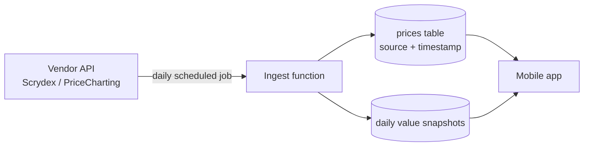

# Price Data Source

Back to [[Index]]. Architecture context: [[07 - Technical Architecture]].

> [!warning] Status: 🚧 decision in progress
> Research done 2026-10-21 using web search. **No vendor has been contacted and no terms have been read in full.** Several sources below are vendors writing about their competitors. Facts marked ✅ come from the vendor's own page; everything else is ⚠️.

## What we need

| # | Requirement | Must / Should |
| --- | --- | --- |
| R1 | **Licensed for commercial use**, including showing prices to our users in the app | Must |
| R2 | Pokémon **raw cards** (by condition), **graded cards** (by grader + grade) and **sealed product** | Must (sealed: Should for Phase 1) |
| R3 | Updated at least **daily** | Must |
| R4 | **Price history** to draw value-over-time charts | Should (we can build our own by saving daily snapshots) |
| R5 | Catalog data: sets, card numbers, images we're allowed to display | Must |
| R6 | Affordable at MVP scale; cost grows with the catalog we refresh, not with the number of users | Must |
| R7 | Our database can store prices (we cache, rather than call the vendor on every screen) | Must |

## Options

### TCGplayer API: ❌ not available
- ✅ TCGplayer's docs say it is **no longer granting new API access**. Existing key holders keep access.
- So it's ruled out, even though its "market price" is the number many collectors use.

### TCGCSV: ❌ not recommended
- ⚠️ Publishes daily copies of TCGplayer catalog and price data in the TCGplayer API's format (per a third-party guide).
- Unofficial; there's no licence from TCGplayer, so building a commercial product on it is a legal risk (fails R1). Fine for personal prototyping only.

### Scrydex (successor to pokemontcg.io): ⭐ leading candidate for cards
- ✅ Scrydex's FAQ says it is the **official successor to pokemontcg.io**, and the old API will get an end-of-life announcement.
- ✅ Pricing page: **Starter $29/month (5,000 credits)**, Growth $99 (50,000), Professional $399 (250,000), Enterprise custom. Most requests cost 1 credit; price history costs 3.
- ✅ Every plan includes **raw and graded prices**, population reports, price trends, price history and image recognition.
- ✅ Covers Pokémon plus Lorcana, Magic, One Piece, Gundam and Riftbound, which helps later expansion.
- ⚠️ **Sealed product coverage not confirmed** on its pages.
- ⚠️ Unknown: how many cards one request returns (this decides whether a daily refresh fits in 5,000 credits); what the licence allows us to display; which marketplaces its prices come from.

### PriceCharting: candidate for sealed (and a second graded source)
- ✅ The API needs a **paid subscription**; access uses a token; JSON responses.
- ⚠️ Price, Pokémon graded coverage, sealed coverage and commercial licence terms **not found online**. Another tracker says its sealed prices come from PriceCharting, which suggests sealed coverage exists.

### JustTCG: alternative for raw cards
- ✅ Official SDK mentions prices by condition and printing, graded cards and historical data.
- ⚠️ Plans, free tier limits and sealed coverage not confirmed (sources disagree).

### PokemonPriceTracker: alternative, Pokémon-only
- ✅ Its own page lists 3 marketplaces, daily updates, 6 months of history, graded and bulk lookups (up to 100 cards per request).
- ⚠️ Prices not found; it also runs a consumer price tracker, so it's partly a competitor.

### TCG Price Lookup: new, unproven
- ✅ Launched a commercial price API in June 2026 covering 8 games and 300,000+ cards, with TCGplayer and eBay prices (per its press release).
- ⚠️ Too new to judge reliability; terms unknown.

### eBay sold-listing data: not for MVP
- ⚠️ eBay's API access to sold-item data is restricted. Not worth pursuing until we have a reason.

## Comparison

| | Commercial licence | Raw | Graded | Sealed | History | Published price |
| --- | --- | --- | --- | --- | --- | --- |
| TCGplayer API | ❌ closed | — | — | — | — | — |
| TCGCSV | ❌ unofficial | ✅ | ❌ | ⚠️ | ❌ | Free |
| **Scrydex** | ⚠️ check terms | ✅ | ✅ | ⚠️ | ✅ | ✅ from $29/mo |
| PriceCharting | ⚠️ check terms | ⚠️ | ⚠️ | ⚠️ likely | ⚠️ | ❌ not found |
| JustTCG | ⚠️ | ✅ | ✅ | ⚠️ | ✅ | ❌ not found |
| PokemonPriceTracker | ⚠️ | ✅ | ✅ | ⚠️ | ✅ 6 mo | ❌ not found |
| TCG Price Lookup | ⚠️ | ✅ | ⚠️ | ⚠️ | ⚠️ | ❌ not found |

## Recommendation (proposed)

1. **Make Scrydex the main candidate** for Pokémon cards (raw + graded + catalog). It has public pricing, is the official successor to pokemontcg.io, and covers other games for later.
2. **Choose a sealed-product source separately** if Scrydex doesn't cover it. PriceCharting is the first to ask.
3. **Don't lock in.** Use one internal "price provider" layer, so swapping or adding a source means writing a new adapter, not changing app code.

## How we'd use it

- The app **never calls the vendor directly**. A scheduled job fetches prices into our database once a day. That keeps cost fixed regardless of user count (R6) and keeps the API key off users' phones.
- Every price row stores its **source and timestamp**, so the app can show "TCGplayer market, updated 6 h ago".
- We save our own daily snapshots, so value history keeps building even if we change provider.
- Refresh **cards people actually hold or watch** first, then the rest of the catalog as credits allow.

## Questions to send vendors

**To Scrydex:**
1. Does the licence allow showing prices and images to users in a commercial app? Any attribution required?
2. Can we store prices in our own database and keep history after cancelling?
3. How many cards does one list or search request return? Can we fetch prices for a whole set in one call?
4. Do you cover Pokémon sealed product (booster boxes, ETBs, etc.)?
5. Which marketplaces do your raw and graded prices come from, and how often do they update?
6. Is there a free or trial plan for development?

**To PriceCharting:**
1. API subscription cost, and terms for commercial display in an app.
2. Coverage of Pokémon sealed product and PSA/BGS/CGC graded prices.
3. Rate limits and bulk download options.

## Next steps

- [ ] Read Scrydex's terms of service and API docs.
- [ ] Send the questions above to Scrydex and PriceCharting.
- [ ] Count how many Pokémon cards and sealed products we'd refresh daily, then work out the monthly credits we need.
- [ ] Prototype: fetch one set from Scrydex into a local table and check the data quality against TCGplayer's site.
- [ ] Record the final decision in [[Index]] and in this note.

## Sources

- TCGplayer: [Getting Started (API closed to new users)](https://docs.tcgplayer.com/docs/getting-started), [API terms](https://help.tcgplayer.com/hc/en-us/articles/360061115874-TCGplayer-API-Terms-Conditions)
- Scrydex: [Pricing](https://scrydex.com/pricing), [FAQ](https://scrydex.com/faq)
- PriceCharting: [API documentation](https://www.pricecharting.com/price-guide?f=home)
- JustTCG: [JS SDK](https://github.com/justtcg/justtcg-js)
- PokemonPriceTracker: [Price API](https://www.pokemonpricetracker.com/pokemon-price-api)
- TCG Price Lookup: [Launch press release](https://norfolkdailynews.com/online_features/press_releases/tcg-price-lookup-launches-real-time-price-api-for-8-trading-card-games/article_3a2d2558-ac2e-5197-bd90-fc4fcdb8b74f.html)
- Comparisons by vendors (biased): [CardGrader.ai: TCGplayer API alternatives](https://cardgrader.ai/blog/tcgplayer-api-alternatives), [CardGrader.ai: Pokémon card API guide](https://cardgrader.ai/blog/pokemon-card-api), [ScrapingBee: Pokémon card APIs](https://www.scrapingbee.com/blog/pokemon-card-api/)
